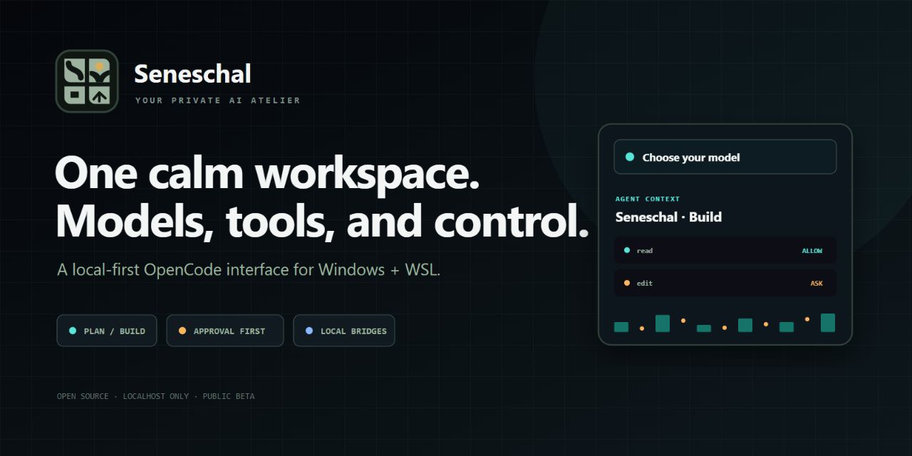
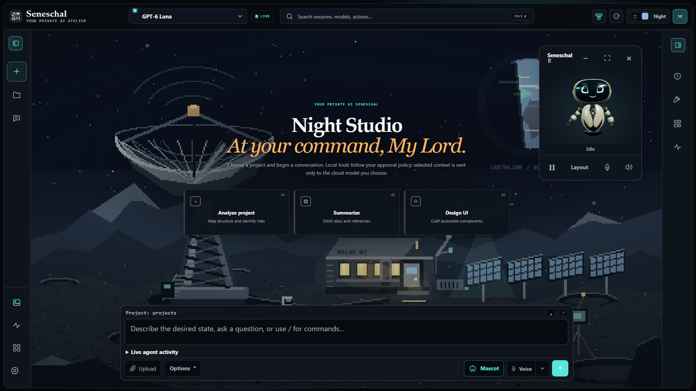
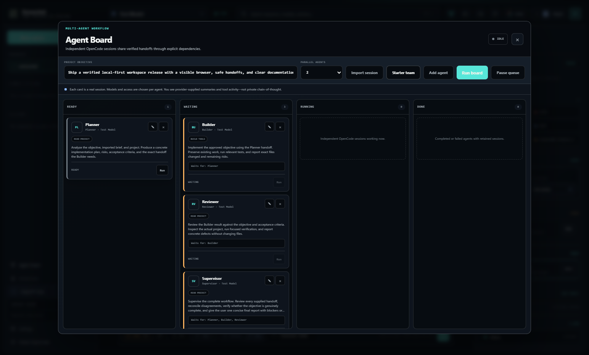

# Seneschal

**Your private AI atelier.**



Seneschal gives OpenCode a personal workspace on Windows and WSL: per-session models, Plan/Build/Chat roles, explicit approvals, projects and skills, a multi-agent board, browser/Blender/VS Code integrations, local Activity history, optional cloud speech, a 3D companion, animated wallpapers and English/Persian controls.

This is a public beta. It is useful today, but it is not a replacement for understanding which model provider you are using or what an approved tool action can change.

**New here? Start with the [user guide](docs/USER-GUIDE.md).** It explains the controls, permission choices, voice, mascot, Activity, phone access and practical workflows in plain language. The November 1 source update is newer than the last packaged ZIP; this commit does not publish a new installer or release asset.

## What it is

### Reading, updates, and activity

Responses render Markdown tables, headings, lists, quotes, and code blocks. Wide tables scroll inside the message instead of overflowing the workspace.

In **Settings → App updates**, check GitHub anytime and install a newer published ZIP release. Downloads must match GitHub's SHA-256 digest. The updater backs up managed app files under `data/update-*`, preserves `data`, `config`, and model/browser runtimes, then restarts. Stop active agents before updating. Source Git checkouts are deliberately excluded; update those with Git. Failures are recorded in `data/update.log`.

Open **Activity** for native Overview, Sessions, Usage and Service views. The optional pinned [Agent Trail](https://github.com/camtrik/agent-trail) runtime reads and indexes local OpenCode history; preparing it requires WSL, Node 22+, npm and internet. Live progress captured in the current window is separate from persistent history. Neither reveals private reasoning the provider does not expose. See [Activity integration](docs/ACTIVITY-INTEGRATION.md) and [startup](docs/ACTIVITY-STARTUP.md). Keep the history service's ports private.

### Voice, companion and personal workspace

- Browser speech and optional **NVIDIA cloud voice** are separate from the selected chat model. Cloud speech requires explicit consent and supported provider access; trial limits and provider processing still apply. Mic and speaker have separate mute controls.
- The bundled **Seneschal 3D companion** follows listening, thinking and speaking. Move/resize it, dock it, rotate the camera, minimize it or open the full-screen companion view. Assets and Three.js modules are local.
- **Wallpapers** includes nine animated scenes plus still/geometric options, full-scene interaction controls and reduced-motion support. No model or audio call is needed for the art.
- English and **فارسی** include translated help and right-to-left panels, while drafts, chat content and technical paths retain their original values. Hover or hold a control for a short explanation.
- Compact sidebar shortcuts, collapsible prompt options and completed tool results keep the workspace usable on small screens. Motion feedback preserves document flow and respects reduced-motion settings.
- **Private Phone Access** pairs your own browsers through Tailscale. The PC still runs the engine; gateway preparation and sensitive controls remain PC-only. Read the [setup guide](docs/PRIVATE-ACCESS-SETUP.md) before enabling it.

- A custom browser interface served only on `127.0.0.1`
- A secure local proxy in front of OpenCode's server
- A Windows launcher for an OpenCode installation inside WSL
- A visual editor for persona, general instructions, project instructions, roles, and reusable skills
- A permission-oriented workspace where Plan is read-only and Build asks before changes by default
- A persistent Agent Board that can turn one selected plan response into an automatically designed team, then coordinate model-specific workers through explicit dependencies, visible rework requests, and a responsible supervisor
- A local VS Code bridge plus an optional in-editor Seneschal panel with project sessions, connected models, Plan/Build modes, explicit code context, tool activity, and edit review

It is not an AI model, a provider subscription, or a way around provider usage limits.

## Interface



The image above is a privacy-safe screenshot of the current interface, showing the softened city wallpaper, compact sidebar shortcuts, prompt controls and Seneschal companion. It contains no personal conversations or provider credentials.

### Session organization and readability

Use the pencil in the session header to rename a conversation, or the folder-arrow button to organize it under another project. Project assignments are saved in Seneschal's `data/session-projects.json`, independently of engine refreshes, and survive a reload. Moves retain the conversation, model, pins, and archive state and expand the destination list. A running session must finish first. This changes where the session appears in Seneschal; the engine retains its original working folder, which is shown in the move dialog and session header. Start a new session in the destination project to work in that folder. Classic OpenCode and other clients may still show the original project.

Sending a selected plan message to Agent Board saves the exact plan and a default implementation/checking/supervisor team before AI customization begins. If customization fails, that default board remains available for review and execution. Expand **Read the selected plan** to inspect the brief. Worker completion requires a completed reply from the current run, not an older reply or partial text. Independent workers can run up to the configured parallel limit.

Conversation text is 16 px, code is 13 px, and headings use Palatino with Segoe UI for controls. Both themes provide stronger secondary-text contrast. On narrower windows the inspector opens as a drawer to preserve room for the conversation.

### Agent Board



Every board card is a real OpenCode session with its own model, role, access profile, status, and retained transcript. Use **To board** on one assistant plan response and a Board Architect will propose the team size, roles, tasks, access, dependencies, and parallel-work limit from only that selected message. You can still import a full planning session, use the Starter team, or build a custom team. Up to eight agents can run in parallel. A downstream agent starts only after all selected dependencies complete and receives their output as a labelled handoff.

Each card can be stopped, edited, retried, or opened as a retained board session. Board Architect and worker sessions stay out of the ordinary Sessions, pinned Sessions, archive manager, project counts, and command search, so multi-agent operations do not clutter normal conversations. Agents can send explicit, visible correction requests to one another; requested agents run another pass and the requester rechecks the result, with an iteration limit to prevent loops. The Supervisor is not a special hidden process: it is a configurable board agent, can use any connected model, owns final acceptance, and depends on every worker it must check. Seneschal shows provider-supplied reasoning summaries, tool activity, requests, and final handoffs; private chain-of-thought is not exposed. Boards are saved locally in `data/agent-board-history/`. Open them from the separate **Board history** view to load the exact saved team without resending the plan or running the Board Architect again; linked sessions and project files are preserved.

## Requirements

- Windows 11
- WSL with an installed Linux distribution (Ubuntu is the default)
- Node.js 20 or newer on Windows; Node 22.16+ is recommended and required for SQLite backup features
- OpenCode installed and working inside that WSL distribution
- At least one model provider connected through OpenCode

Brave is preferred when installed. Otherwise, Seneschal opens in the Windows default browser. When the Playwright integration is installed, its Browser control can switch the separate agent-controlled Brave window between hidden and visible mode. Explicit browser requests automatically enable visible mode before the task starts, Seneschal repairs older launchers at startup, and it brings the real Playwright window forward when it appears. VS Code is detected locally and opens WSL folders through the installed Remote WSL support. Blender and browser automation remain optional and require their own local integrations.

## Install

1. Download the latest beta ZIP from [Releases](https://github.com/Rammeshgar/seneschal/releases).
2. Extract it to a normal folder.
3. Double-click `install.cmd`.
4. Open **Seneschal** from the desktop shortcut.

The installer copies the app to `%LOCALAPPDATA%\Seneschal`, detects the WSL home folder, creates a local desktop shortcut, and preserves any existing OpenCode configuration. If your distribution is not named Ubuntu, run:

```powershell
powershell -ExecutionPolicy Bypass -File .\install.ps1 -WslDistribution "YourDistroName"
```

## Providers and cost

Provider accounts and API keys stay in OpenCode; this interface does not put credentials in its frontend. ChatGPT subscriptions and provider APIs are separate products. A model labelled free can still be temporary, rate-limited, or unavailable upstream.

The `$10` display is a soft local target. Set a real hard limit with the provider whenever the provider supports one.

## Security and privacy

- The workspace binds to localhost, not the local network.
- A random local session secret and a separate OpenCode server password are generated at first launch.
- Runtime secrets, sessions, backups, and settings live in `data/`, which is excluded from Git.
- Share links are disabled in the starter OpenCode configuration.
- Existing OpenCode configuration files are not overwritten by the installer.
- Any cloud model you select still receives the prompt and context required for the request.

Read [SECURITY.md](SECURITY.md) before exposing or modifying the local server.

## Integrations

- **Agent Board:** built in; send one plan response to automatically design a team, or import the full current session. Choose each worker's model/access/dependencies, run or stop cards independently, review visible rework requests, restore saved boards, and keep every linked session.
- **Visual Studio Code:** built in when `Code.exe` is detected. The optional local companion adds a Seneschal Activity Bar panel with per-session model selection, Plan/Build modes, current selection/file context, response and tool activity, stop, full-session opening, and Source Control review. It remains separate from GitHub Copilot.
- **Playwright Brave:** optional MCP integration; tasks can run hidden or in a visible agent-controlled window.
- **Blender:** optional MCP integration with local bridge status and launch control.

The public beta does not silently install browser extensions, MCP servers, Blender add-ons, VS Code extensions, or paid services.

## Settings

Machine-specific values are stored locally in `%LOCALAPPDATA%\Seneschal\data\settings.json`:

```json
{
  "wslDistribution": "Ubuntu",
  "wslLinuxHome": "/home/yourname",
  "launchDirectory": "/home/yourname/projects",
  "blenderExecutable": "C:\\Program Files\\Blender Foundation\\Blender 5.1\\blender.exe"
}
```

The Blender entry is optional; common installed versions are detected automatically.

## Known limits

- Windows/WSL only in this beta
- Upstream OpenCode API changes can break parts of the interface; the older-conversation permission migration is explicitly gated to the verified 1.19.0 contract
- Provider model lists and capabilities are controlled by OpenCode and the provider
- Full private model reasoning is not exposed; the UI can show provider-supplied summaries and live tool activity
- Browser and Blender bridges must be installed separately; Seneschal can repair its older hidden-only Playwright launcher but cannot create a missing Playwright installation
- Agent Board handoffs and correction requests use completed textual outputs; files remain shared through the selected project folder, and automatic rework is limited to prevent loops
- The VS Code companion provides chat and agent-driven editing but does not replace inline autocomplete or GitHub Copilot's proprietary UI
- The local cost figure is informational, not a guaranteed cap
- Phone Access requires a qualified installation, a supported personal Tailscale setup and a running PC; it is not cloud hosting
- Cloud speech access may be limited or unavailable, and browser speech support varies by browser/OS

## Development

```powershell
npm test
npm start
```

The server intentionally has no npm runtime dependencies.

Use Node 22.16+ for the complete test suite, including SQLite fixtures. The November source refresh passed 288 source tests and 207 separate Phone Access checks in offline containers; see [validation scope](docs/VALIDATION.md).

Phone Access has a separate offline verifier, `scripts/verify-private-access.ps1`, which requires Docker Desktop and an already-installed official Node image. Runtime state, keys, histories, backups and qualification proofs are local data and are never included in source releases. Optional browser and raster tests use separately installed tooling; see their usage headers.

## License

Seneschal is MIT licensed. OpenCode's license is included separately in `docs/OPENCODE-LICENSE.txt`.

## Images and screenshots

- Public product visuals live in `docs/images/`.
- Reusable logos, GitHub previews, LinkedIn artwork, and source files live in `assets/`.
- Put images that must appear inside the running interface in `app/assets/`; reference them as `/workspace/assets/filename.webp`.

Prefer WebP or AVIF for large interface backgrounds, PNG for screenshots, and SVG for logos. Do not place personal screenshots, API keys, browser profiles, or private session content in the public repository.
